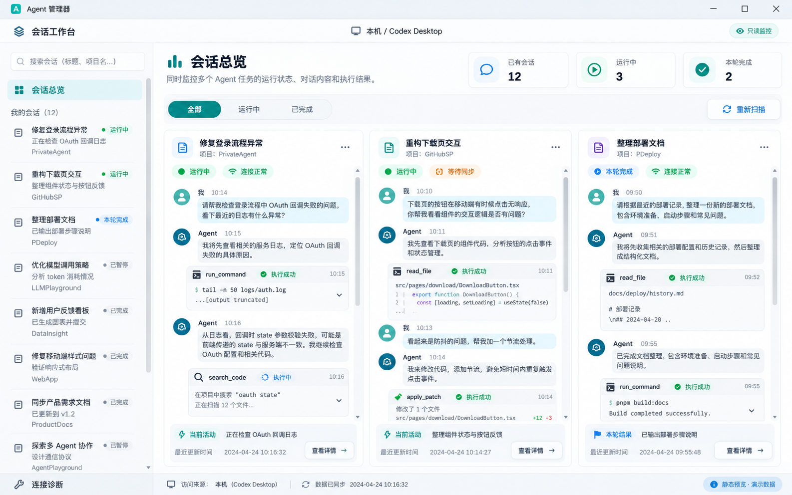

# Agent Manager · Agent 管理器

面向 Windows 的原生多 Agent 会话工作台，把 Codex Desktop、OpenCode Desktop 和 DeepSeek Harness Desktop 的已有会话集中到一个窗口，查看消息、工具输出与任务状态。

项目使用 Rust + Slint 1.18.1、Winit 和 FemtoVG-WGPU 绘制界面，不依赖 WebView。当前版本为 `0.1.0`，支持 Windows x64。

**当前定位是只读监控。** 任务继续在原应用中运行；管理器不发送消息、创建或恢复会话、执行任务命令、中断任务或回复审批。关闭管理器只会停止自己的订阅和连接。

## 已实现功能

- **多会话总览**：并排查看消息流，优先展示运行中的会话，也可手动加入或移出总览。
- **搜索与筛选**：按标题、项目名、来源及运行中、本轮完成、状态待确认筛选。
- **集中阅读**：会话详情展示消息、工具输出、任务信息和连接状态；窄窗口可展开“任务信息”。
- **原生消息交互**：鼠标选择、`Ctrl+C`、复制消息原文，展开长消息及工具输出；支持标题、段落、列表和代码块。
- **保留阅读位置**：向上阅读时停止跟随，可点击“回到最新消息”；总览和详情分别保留阅读状态。
- **独立连接管理**：按来源扫描、重连和显示同步状态；断线时保留缓存并标注“上次”状态。
- **观察插件管理**：在“接入管理”中检测、安装、更新或卸载 OpenCode 与 Harness 插件。
- **回到原应用**：Codex 可通过已注册的协议跳转到会话；OpenCode 和 Harness 提供会话标识复制。

总览选择、筛选和阅读位置仅在本次运行中保留。任务状态与连接状态分别显示：断线不代表任务失败，空闲也不自动代表本轮完成。

## 接入范围

| 来源 | 接入方式 | 当前版本范围 |
| --- | --- | --- |
| Codex Desktop | 只读索引发现 + 本机内部 IPC | 历史本机验收基线为安装包 `26.1013.3656.0`、应用清单 `26.1013.31256`，IPC 协议版本 1 |
| OpenCode Desktop | 原应用加载内置观察插件 | `1.18.27`，安装与连接时校验版本 |
| DeepSeek Harness Desktop | 原应用加载 Cordis 观察插件 | `0.2.0-rc.2`，安装与连接时校验版本 |

Codex 的内部 IPC 不属于稳定的公共接口；以上基线不代表其他版本或后续升级已通过验证。OpenCode 和 Harness 当前拒绝不匹配的版本。CLI、WSL、远程服务及其他 Agent 尚未纳入。

## 获取源码与运行

### 环境要求

- Windows x64。
- Rust MSVC 工具链，`Cargo.toml` 声明最低 Rust 版本为 `1.92`。
- Visual Studio C++ 构建工具及 Windows SDK。
- PowerShell 7，用于构建、打包和验收脚本。
- Node.js、Python 用于测试、诊断或预览工具。运行编译后的管理器无需全局 Node.js、Python 或 Agent CLI。

### 从源码启动

```powershell
git clone https://github.com/lkuliuying/Agent-Manager.git
Set-Location Agent-Manager

# 首次构建需要下载 Cargo.lock 中锁定的依赖
.\scripts\build-native.ps1

# 先查看演示界面，不连接真实会话
.\target\x86_64-pc-windows-msvc\debug\agmanage.exe --demo

# 正常启动，连接本机已有会话
.\target\x86_64-pc-windows-msvc\debug\agmanage.exe
```

依赖缓存完整时，可使用 `.\scripts\build-native.ps1 -Offline` 离线构建。脚本始终使用 `--locked` 和 `x86_64-pc-windows-msvc` 目标，不会主动更新锁文件。

### 生成本地便携包

```powershell
.\scripts\package-native.ps1

# 已缓存全部依赖时
.\scripts\package-native.ps1 -Offline
```

打包脚本构建启用静态 CRT 的 Release 版本，在 `artifacts/agmanage-windows-x64-<时间>/` 生成 `AgentManager.exe`、README 和包含 SHA-256 的 `manifest.json`，并更新本机的 `artifacts/latest-package.json`。可直接启动包内的 `AgentManager.exe`。

仓库保存源码和设计资料，编译目录、安装包及本机运行报告不随源码上传。本地包尚未签名。

## 连接已有会话

### Codex Desktop

1. 在 Codex Desktop 中打开需要监控的会话。
2. 使用同一 Windows 用户启动管理器，等待自动发现与同步。
3. 在总览或详情中阅读；需要继续任务时，点击“在 Codex 中查看”回到原应用。

发现范围是本机已有所有者的会话，不会为读取内容而恢复历史任务。索引默认从 `%USERPROFILE%\.codex` 读取，也支持 `CODEX_HOME`。跳转使用 `codex://threads/<id>`，能否导航取决于当前安装版的协议注册。

### OpenCode Desktop 与 DeepSeek Harness Desktop

1. 打开“接入管理”，选择对应来源并点击“检测”。自动检测失败时，填写原桌面程序的 `.exe` 路径后重新检测。
2. 点击安装或更新观察插件。插件随管理器内置，由原应用的插件机制加载。
3. **OpenCode**：在方便时重新打开原应用，使插件生效。
4. **Harness**：先在原应用插件页重新启用观察插件，必要时重新打开应用。
5. 回到管理器查看来源连接状态，按需扫描或重连。

管理器不会自动重启原应用。Harness 的检测和安装会校验依赖包文件及启用项；“文件已校验”仍需原应用实际加载插件后才能连接。OpenCode 的项目级配置若覆盖全局插件列表，需要保留本项目的插件注册。

会话目录和正文按需读取，发现会话不等于已获得完整历史；界面会显示历史完整性。Harness 使用 `sessionQuery` 和公开事件读取内容，不调用可能激活冷会话的 `sessionController.follow`。

## 数据与安装行为

普通运行中的会话正文只缓存在内存，不创建消息日志或离线历史文件。验证报告记录计数与固定错误分类，界面截图使用演示数据。

观察插件通过当前用户专属、拒绝远程客户端的 Windows 命名管道连接管理器。共享文件存放在 `%USERPROFILE%\.agmanage`：

| 内容 | 用途 |
| --- | --- |
| 观察插件文件 | 供原应用加载本项目插件 |
| `installation-*.json` | 记录已选择的原应用路径 |
| `observer.json` | 保存当前观察通道地址与协议版本 |
| `observer-health-*.json` | 记录加载阶段、固定错误码、版本及进程号 |

共享目录放在用户主目录，避免部分打包应用对 AppData 的私有重定向。旧版安装可通过“安装／更新”迁移本项目注册项，旧目录会保留。

安装操作会修改对应原应用的插件注册：OpenCode 保留其他插件和 JSONC 注释；Harness 只修改 `desktop` profile。卸载只移除本项目注册项，以及内容仍与内置版本一致的受管文件；已加载的插件需原应用重启后完全退出。

## 验证

### 核心逻辑与插件测试

```powershell
cargo test --locked --target x86_64-pc-windows-msvc
node --test verification/observer.test.mjs
```

Rust 测试覆盖状态解析、增量原子性、来源隔离、只读请求边界、大快照分帧及插件注册保留；Node 测试覆盖插件读取契约、流式缺口、观察回调、命名管道更新与重连。依赖已缓存时，Cargo 命令可增加 `--offline`。

### 合成通道与原生交互

先按前文构建 Debug 程序，再执行：

```powershell
node verification/run_observer_fixture.mjs
.\target\x86_64-pc-windows-msvc\debug\agmanage.exe --verify-ui
```

合成通道验证使用独立目录和演示会话，检查不同来源中相同会话标识的隔离；`--verify-ui` 使用演示数据检查原生交互。这些结果不能替代真实来源接入验收。

### 真实桌面接入验收

```powershell
# 需要至少三个已在 Codex Desktop 中打开的会话，并有会话持续产生增量
.\verification\run_native_acceptance.ps1

# 在上述条件下，OpenCode 与 Harness 也各有至少两个可读取的已有会话
.\verification\run_native_acceptance.ps1 -RequireAllSources

# 单独探测 OpenCode 与 Harness，报告不保存真实正文或会话标识
.\target\x86_64-pc-windows-msvc\debug\agmanage.exe --probe-observers --seconds 15 --probe-output artifacts\observer\live-result.json
```

完整验收检查原生窗口、选择复制、四档进程内渲染缩放、正文同步、增量、管理器重连、退订和原应用进程连续性。`-RequireAllSources` 要求三个来源分别取得正文快照，目录条目不能替代正文读取，异常重连也不能作为通过依据。

请在正常登录用户的桌面环境运行真实接入及剪贴板检查；受限令牌环境的管道访问结果不能代表原桌面应用。验收会写入或更新本机 `artifacts/` 报告；`verification/*.json` 是历史探测输出，也已忽略。克隆仓库不会带入这些报告，文档提及的历史本机验收不代表新环境已经验证。

## 界面与代码结构

下图为早期审阅通过的**静态设计预览，使用演示数据**。当前多来源界面请通过 `--demo` 查看；此图不作为当前运行截图或交互验收证据。



更多设计参考：[会话详情](preview/approved/02-detail.png)、[断线状态](preview/approved/03-reconnect.png)。产品约束见 [PRODUCT.md](PRODUCT.md)，视觉与交互约定见 [DESIGN.md](DESIGN.md)。`preview/brief.json` 和 `preview/review-result.json` 保留早期设计阶段的记录；重新运行预览绘制脚本需要 Python、Pillow 和相应的本地探测报告。

| 路径 | 职责 |
| --- | --- |
| `src/app.rs` | UI 线程上的选择、筛选、阅读状态与模型更新 |
| `src/state.rs`、`src/source.rs` | 消息、任务状态、来源身份和会话键 |
| `src/codex_state.rs`、`src/monitor.rs` | Codex 历史解析、增量处理、索引发现、IPC、重同步与退出清理 |
| `src/observer.rs`、`src/installation.rs` | 插件通道、版本校验、独立重连与安装管理 |
| `src/native.rs` | 系统协议发现及原应用导航 |
| `src/gate.rs`、`src/ui_check.rs`、`src/probe.rs` | 原生能力、界面交互和观察来源验证入口 |
| `ui/`、`assets/` | Slint 页面、组件、设计令牌和 SVG 图标 |
| `plugins/` | OpenCode 插件、Harness Cordis 插件与共享观察实现 |
| `scripts/` | Windows 构建与便携包生成 |
| `verification/` | 回归测试、合成通道、真实接入验收与诊断工具 |
| `preview/` | 早期静态设计稿、审阅记录和绘制脚本 |

## 已知限制

- 接入依赖指定桌面版本和其提供的历史范围。索引或消息结构不兼容时会提示失败，不接管或恢复原任务。
- Codex IPC 使用四字节小端长度前缀，当前接收上限为 256 MiB；空帧、超限帧和无效 JSON 会拒绝。该上限是当前实现约束，不代表所有桌面版本的协议保证。
- 代码块采用等宽文本，尚无 IDE 级语法着色，也不支持跨消息块连续选择。
- 四档 `SLINT_SCALE_FACTOR` 验证只模拟进程内渲染缩放，不能替代真实跨显示器拖动检查。
- 尚未完成全新 Windows 安装、其他 Desktop 版本和不同显卡的兼容验收，也没有性能收益承诺。
- 权限审批、消息发送及任务控制暂未实现。
